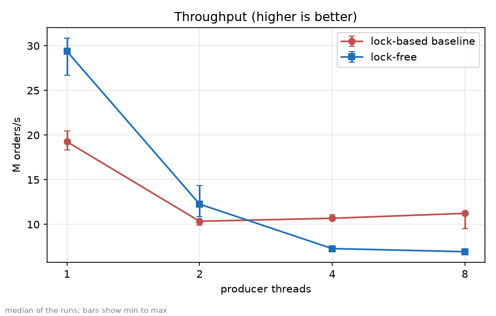
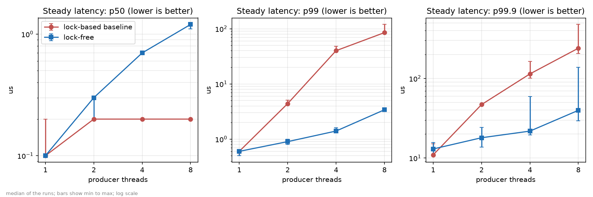
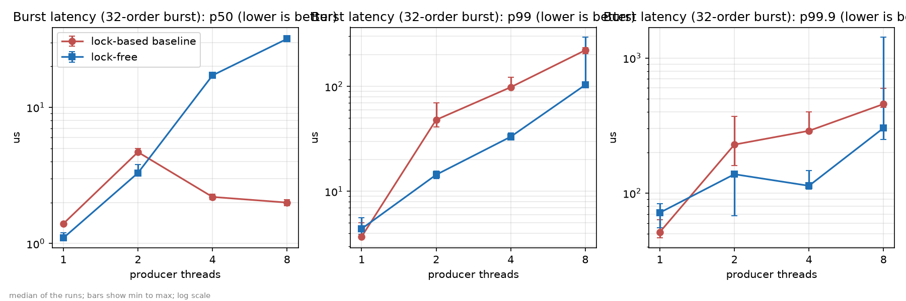

# Results and methodology

*Written by Person B (Esther Philemena S). The tables, the inference lines, the environment description and the
stability and warm-up counts below are generated from the frozen result files by `report/charts/make_charts.py`, so
every number in them is exactly the number in `results/<date>/`. The prose around them is hand-written, and every
comparative statement in it is checked against the data (the ids such as C3 in comments refer to that check).*

## 1. What was measured

Both engines receive the same stream of limit orders from 1, 2, 4 or 8 client threads (the *producers*), and three
things are measured:

| Benchmark | What one sample is | Reported as |
|---|---|---|
| Throughput | one order handed to the engine, without waiting for it to be processed | orders per second the engine sustains with all producers pushing as fast as they can |
| Steady latency | one order, from the `submit` call until that order is fully processed | latency percentiles p50, p99, p99.9 (constant load of one in-flight order per producer) |
| Burst latency | a burst of 32 orders back to back, until the last one is fully processed | latency percentiles p50, p99, p99.9 of whole bursts |

The latency definition is identical for both engines. The baseline processes an order inside `submit`, so its wait
ends immediately; the lock-free engine returns from `submit` once the order is in the ring buffer, and the benchmark
then waits until the matching thread has processed it.

**Workload.** Random orders in a tight price band (10,000 +/- 3 ticks), quantity 1 to 5, generated from fixed seeds so
that both engines see exactly the same orders. Every buy is at or above the mid price and every sell at or below it,
so opposite orders always cross, almost every order trades, and quantities come in equal buy/sell pairs so the book
cannot grow with the length of the run. (The engines have no cancel; without these two rules the book would grow
without limit and the benchmark would measure memory growth instead of matching.)

## 2. Experimental setup

<!-- BEGIN GENERATED: environment -->
* OS: Windows-11-10.0.26200-SP0
* CPU: AMD64 Family 23 Model 104 Stepping 1, AuthenticAMD (logical cores: 12)
* Java: openjdk version "25.0.4.1" 2026-08-18 LTS
* Python: 3.14.6
* Code version (git): lockfree-freeze-2-g904ae70-dirty (commit 904ae70)
* Producer counts: 1, 2, 4, 8
* Settings: warm-up 3 x 2 s, measurement 5 x 3 s, 2 forks (annotation defaults)

\- Laptop: <Manufacturer Model>, <CPU name>, <RAM> GB

\- Plugged in: yes

\- Power mode: Best performance

\- Sleep disabled: yes

\- Other applications closed: yes (<add any exception, e.g. laptop briefly used around 22:26 during run 2>)
<!-- END GENERATED: environment -->

The machine has 12 logical cores, so even with 8 producers plus the one matching thread (9 threads) every thread had a core of its own, and no producer count was distorted by CPU sharing.

All runs used one machine, one JVM and the same JVM flags for both engines. Both engines send trades to a sink that
does nothing, so neither pays for output.

## 3. Method

| Setting | Value |
|---|---|
| Warm-up | 3 iterations of 2 seconds |
| Measurement | 5 iterations of 3 seconds |
| Forks (separate JVMs) | 2 |
| Repeats of the whole suite | 3 runs |
| Producer counts | 1, 2, 4, 8 |

Each figure in this report is the **median over the three runs**, shown with the **minimum to maximum** range, because
a single run is not evidence. No run was repeated or discarded: all three runs completed on the first attempt.

**Stability.** <!-- BEGIN GENERATED: stability -->
28 of 56 measurements exceeded their run-to-run tolerance (15 of them p99.9, 6 of them p99, 4 of them ops_per_s, 3 of them p50).
<!-- END GENERATED: stability --> Tolerances were
10 % for throughput and p50 and 25 % for p99 and p99.9, because high percentiles are estimated from few samples and
naturally vary more. Most unstable measurements are far-tail percentiles (p99.9, and some p99), which rest on few samples, plus a few p50 values at the 100 ns timer resolution, where one clock step already counts as a large spread; the worst case is the lock-free burst p99.9 at 8 producers, where one run reached 1,421 us against about 250 to 300 us in the others. The report therefore gives every figure as the median of three runs with its minimum-to-maximum range, and only calls a difference "clear" when the two engines' ranges do not overlap.

**Warm-up.** <!-- BEGIN GENERATED: warmup -->
The warm-up check flagged 31 of 144 forks.
<!-- END GENERATED: warmup --> Of the 31 flagged forks, 30 were latency benchmarks (26 steadyLatency, 4 burstLatency) and only 1 of 48 throughput forks was flagged. The differences went in both directions: sometimes the last warm-up iteration was slower than the measured mean, sometimes faster. If warm-up were too short, the measured iterations would be consistently faster than warm-up. The check compares means, and the mean of a heavy-tailed latency distribution is dominated by a few rare slow samples, so these flags reflect noise in the mean rather than incomplete warm-up. Throughput, which is the most sensitive to JIT warm-up, was stable. The warm-up settings were therefore kept and the runs were not repeated.

## 4. Results







<!-- BEGIN GENERATED: tables -->
**Throughput, in millions of orders per second** (median of the runs, with the min to max range in brackets)

| Producers | Metric | Lock-based baseline | Lock-free |
|---:|---|---:|---:|
| 1 | orders/s | 19.26 [18.35 to 20.49] | 29.38 [26.72 to 30.87] |
| 2 | orders/s | 10.35 [9.92 to 10.39] | 12.27 [10.85 to 14.35] |
| 4 | orders/s | 10.68 [10.63 to 11.06] | 7.29 [7.25 to 7.32] |
| 8 | orders/s | 11.23 [9.53 to 11.26] | 6.94 [6.93 to 6.96] |

**Steady latency, in microseconds** (median of the runs, with the min to max range in brackets)

| Producers | Metric | Lock-based baseline | Lock-free |
|---:|---|---:|---:|
| 1 | p50 | 0.1 [0.1 to 0.2] | 0.1 [0.1 to 0.1] |
| 1 | p99 | 0.6 [0.5 to 0.6] | 0.6 [0.5 to 0.6] |
| 1 | p99.9 | 10.9 [10.7 to 15.1] | 13.0 [10.8 to 15.6] |
| 2 | p50 | 0.2 [0.2 to 0.2] | 0.3 [0.2 to 0.3] |
| 2 | p99 | 4.4 [4.2 to 5.1] | 0.9 [0.8 to 1.0] |
| 2 | p99.9 | 47.0 [46.1 to 47.9] | 18.0 [13.7 to 24.2] |
| 4 | p50 | 0.2 [0.2 to 0.2] | 0.7 [0.7 to 0.7] |
| 4 | p99 | 40.1 [37.6 to 48.3] | 1.4 [1.4 to 1.6] |
| 4 | p99.9 | 114.2 [100.8 to 164.6] | 21.8 [19.4 to 59.2] |
| 8 | p50 | 0.2 [0.2 to 0.2] | 1.2 [1.1 to 1.2] |
| 8 | p99 | 85.1 [82.2 to 119.7] | 3.4 [3.3 to 3.6] |
| 8 | p99.9 | 240.1 [205.1 to 477.7] | 39.7 [29.3 to 138.0] |

**Burst latency (32-order burst, time until the last order is processed), in microseconds** (median of the runs, with the min to max range in brackets)

| Producers | Metric | Lock-based baseline | Lock-free |
|---:|---|---:|---:|
| 1 | p50 | 1.4 [1.4 to 1.4] | 1.1 [1.1 to 1.2] |
| 1 | p99 | 3.7 [3.6 to 5.0] | 4.4 [3.9 to 5.6] |
| 1 | p99.9 | 51.5 [46.6 to 63.7] | 71.7 [55.4 to 83.4] |
| 2 | p50 | 4.7 [4.6 to 5.0] | 3.3 [3.2 to 3.8] |
| 2 | p99 | 48.1 [41.1 to 70.0] | 14.4 [13.2 to 15.6] |
| 2 | p99.9 | 228.6 [159.9 to 369.2] | 138.0 [68.0 to 142.1] |
| 4 | p50 | 2.2 [2.1 to 2.3] | 17.2 [17.0 to 17.6] |
| 4 | p99 | 98.3 [98.0 to 121.9] | 33.2 [32.1 to 36.0] |
| 4 | p99.9 | 289.1 [281.1 to 399.4] | 113.3 [106.9 to 146.4] |
| 8 | p50 | 2.0 [1.9 to 2.1] | 31.9 [31.4 to 32.7] |
| 8 | p99 | 221.2 [205.6 to 233.0] | 103.4 [97.8 to 293.4] |
| 8 | p99.9 | 456.2 [431.1 to 599.0] | 303.1 [249.1 to 1421.3] |

<!-- END GENERATED: tables -->

**One-line inference per chart**

<!-- BEGIN GENERATED: inferences -->
Reading guide: "clearly better" means the whole min-max range over the runs of one engine is better than the whole range of the other, so the difference is larger than the run-to-run variation. The number in brackets is the ratio of the medians.

- **Throughput:** the lock-free engine is clearly better at 1, 2 (1.5x, 1.2x) producers; the baseline is clearly better at 4, 8 (1.5x, 1.6x) producers.
- **Steady latency p50:** the baseline is clearly better at 4, 8 (3.5x, 6.0x) producers; the min-max ranges overlap (no clear difference) at 1, 2 producers.
- **Steady latency p99:** the lock-free engine is clearly better at 2, 4, 8 (4.9x, 28.6x, 25.0x) producers; the min-max ranges overlap (no clear difference) at 1 producer.
- **Steady latency p99.9:** the lock-free engine is clearly better at 2, 4, 8 (2.6x, 5.2x, 6.0x) producers; the min-max ranges overlap (no clear difference) at 1 producer.
- **Burst latency p50:** the lock-free engine is clearly better at 1, 2 (1.3x, 1.4x) producers; the baseline is clearly better at 4, 8 (7.8x, 15.9x) producers.
- **Burst latency p99:** the lock-free engine is clearly better at 2, 4 (3.3x, 3.0x) producers; the min-max ranges overlap (no clear difference) at 1, 8 producers.
- **Burst latency p99.9:** the lock-free engine is clearly better at 2, 4 (1.7x, 2.6x) producers; the min-max ranges overlap (no clear difference) at 1, 8 producers.
<!-- END GENERATED: inferences -->

## 5. What the data shows

The statements below describe the data only. Possible explanations, and whether each one was tested or is a
hypothesis, are in the engine chapter ("Interpreting the benchmark results").

**Throughput.** The lock-free engine sustained more orders per second than the baseline with 1 and 2 producers
<!-- C1 -->, but the baseline sustained more with 4 and 8 producers <!-- C2 -->. In this benchmark the lock-free
engine's throughput therefore does not scale with the number of producers: the more threads submit at once, the
lower the total rate it sustains.

**Tail latency.** With 2, 4 and 8 producers the lock-free engine's steady-latency p99 was clearly lower than the
baseline's, meaning the ranges over the three runs do not overlap <!-- C3 -->. For burst latency the p99 was clearly
lower at 2 and 4 producers; at 8 producers the lock-free median was still lower (103.4 us against 221.2 us), but one
of the three lock-free runs reached 293.4 us, so the ranges overlap and the difference at 8 producers is not clear
<!-- C4 -->. The ratios are in the inference lines above. This is the result the project set out to test: under
contention, the lock-free design makes the slow outliers much less slow.

**Median latency.** In the middle of the distribution the picture reverses. With 4 and 8 producers the baseline's
median (p50) latency was lower than the lock-free engine's, for steady <!-- C5 --> and for burst <!-- C6 -->
latency. So the lock-free engine was better at the tail and worse at the median. Which of the two matters more
depends on the application; for a matching engine the tail usually matters more, because one slow order can hold up
every order behind it, but the higher typical latency is a real cost and the report states it plainly.

**One producer.** With a single producer there is no contention to remove, and the two engines' p99 medians were
within 25 % of each other <!-- C7 -->. The lock-free engine's advantage appears only when several threads compete.

## 6. Limitations

- **The book stays tiny in this workload** (a handful of resting orders at any time). The results are about the cost
  of handing orders to the matching code and matching them, not about a deep order book.
- **The lock-free engine's book is bounded** (fixed price range and a fixed number of resting orders); the baseline's
  is not. The benchmark's price range was configured to match the workload.
- **The baseline uses a standard, non-fair lock.** A different lock policy could change its median and tail.
- **One machine, one operating system, one JVM.** The numbers are not claims about other hardware.
- **Timer resolution.** On the benchmark machine (Windows) the clock advances in steps of about 100 ns, so values around
  0.1 microseconds are at the resolution limit and comparisons of such values (for example p50 at 1 producer) carry
  little information.
- **High percentiles rest on a limited number of samples**, which is why p99.9 varies most between runs.
- **Throughput counts orders accepted by the engine.** For the lock-free engine the backlog in its ring buffer at the end
  of an iteration is at most one ring buffer (65,536 orders), which is small next to an iteration of three seconds.
- **The code version** the runs used is recorded in the environment description above.
  The working tree differed from the frozen engine code only in the uncommitted Day 6 benchmark scripts (`run_suite.py`, `analyze_runs.py` and the review template); `git diff --stat lockfree-freeze 904ae70 -- src/main` shows no difference, so the engines measured are exactly the frozen engines.

## 7. How to reproduce

```
mvn clean package -DskipTests
python results/run_suite.py --out results/<date> --run 1        # also --run 2 and --run 3
python results/analyze_runs.py --dir results/<date> --runs 1 2 3
python report/charts/make_charts.py --date <date> --check
```

The raw JMH output of every run (`run<N>-t<producers>.json`) and its console log (`.log`) are committed under
`results/<date>/`.
